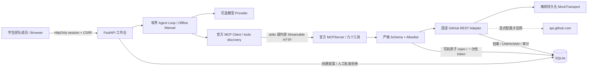

# 架构

## 所有权

- Host/Web 拥有用户会话、CSRF、自然语言任务、模型凭据、提案展示和人类批准入口。
- MCP Server 拥有九个业务工具、GitHub PAT、仓库策略、HTTP 请求预算及执行结果。Agent 不 import Server 的执行函数。
- SQLite 是本地可信应用边界内的共同持久化。两个进程共享 UID 和卷；这不是互相不信任的多租户服务。
- Model 只看到六个 MCP 动态发现的只读工具 Schema。提案是结构化输出，不是执行权限。批准工具不暴露给模型。

## 传输

stdio 是独立 Python 子进程，stdout 只承载 SDK 协议流。Web 创建的 stdio 子进程采用环境变量白名单，不携带模型 Key/PAT，固定 Mock。

Docker 使用 SDK 的 Streamable HTTP，不使用旧独立 SSE transport。MCP 服务只接内部网络，没有 `ports`。新版请求通过 SDK 协商 `2026-07-28`，能力以 `server/discover` 获取。`scripts/mcp_smoke.py` 另外实测 legacy `initialize`，协商 `2025-11-25`。

## 数据模型

`TriageProposal` 包括摘要、类型、标签、缺失信息、相关 Issue、回复和最多三个 ActionDraft。`PendingAction` 在 SQLite 的 actions 表保存不可变参数 JSON、fingerprint、session、status、expires、token_hash、result；前端不接收 token_hash/令牌原文。

`executions.fingerprint` 主键跨会话抑制重复副作用。`audit` 存安全事件和写调用 Trace。`runs` 存分析快照；审批后以 `/api/actions` 的实时状态为准。`budgets` 为同一任务的 Server 请求计数；Mock 表单独命名为 `mock_*`，但仍持久化于同一 DB。

## 关键权衡

不用 LangGraph，因为循环上限、错误终止和少数状态不需要额外图编排。不用 GitHub 官方 MCP Server 的 fork，因为其权限面远超过这个辅助项目。不用数据库事务包住网络调用，避免长期持锁；先持久化占位再发送，代价是崩溃后可能只有占位而没有真正写入。
