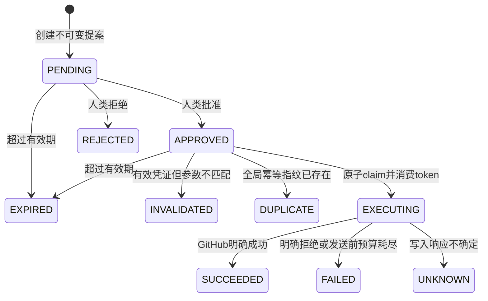

# 权限与审批设计

## 权限矩阵

| 情况 | 判定 | 自动执行 |
| --- | --- | --- |
| Allowlist内、Schema合法的六个读工具 | ALLOW | 是 |
| Allowlist内的 add_labels/post_comment/create_issue | REQUIRE_CONFIRM | 否，必须人工审批 |
| 未注册的工具，包括删除、关闭、Shell、环境读取 | BLOCK | 否；没有危险工具实现 |
| 仓库越权、非法参数、搜索限定符、任意URL字段 | BLOCK | 否 |
| 模型调用任意写工具 | BLOCK_MODEL_TOOL | 否；模型仅能输出提案 |
| 模型将合法操作转向任务以外仓库或Issue | BLOCK_MODEL_SCOPE / BLOCK_ACTION_SCOPE | 否 |

策略存在于 Host 和 Server 两侧。SDK ToolAnnotations 只描述工具性质，不负责授权。Prompt 只提示模型，不是安全边界。

## 一次性审批

PendingAction 保存规范化后的完整参数，禁止原地编辑。用户需要改变内容时创建新提案。fingerprint 为 SHA-256(canonical JSON({tool, arguments}))，args含repo；动作还绑定用户session。网页展示工具、仓库、参数、影响、hash和失效时间，审批请求带用户所见 hash。

批准时生成256位随机token（`secrets.token_urlsafe(32)`），仅在Web内存与MCP调用中传递，SQLite保存token_hash。五分钟有效期从提案创建开始计算，而不是每次点击延长。批准和拒绝写审计。

Server只接受存在的 APPROVED 动作，逐项验证 session、工具名、完整参数指纹、token哈希和过期时间。持有有效凭证却提交变更参数，会把原动作标为 INVALIDATED 并清除 token_hash；旧token随即失效。没有正确token的请求不能任意使别人的审批失效。

## 状态机

EXPIRED目前是读取时根据 expires 派生的状态，同时执行/批准时重新检查；不依赖后台清理作业保障安全。

## 幂等与崩溃

`BEGIN IMMEDIATE` + `executions.fingerprint PRIMARY KEY` 保证并发请求只有一个能取得发送权。这个指纹跨会话、跨重启持续存在。一次claim后最多一次HTTP写尝试；重复批准、重用token、新建相同参数动作都不会导致重复POST。

不能把这叫外部 exactly-once：GitHub可能完成请求但响应丢失，或进程在claim后、发送前崩溃。前者记UNKNOWN，后者可能保留EXECUTING；系统不自动恢复执行。需要操作者通过GitHub核对，再在离线维护流程中决定如何处理；没有危险的“一键强制重试”入口。

成功、失败或UNKNOWN的指纹都作为长期抑制记录。需要未来再次发送完全相同评论时会被抑制，这是保守设计的可用性代价；不要直接删除幂等记录来“修复”状态。Mock DB可以用于实验，真实数据库需先人工核对和备份。

## 重启行为

SQLite保存会话(24小时)、PendingAction、审批hash、幂等与审计。PENDING重启后可继续审批且保持原expires；APPROVED的有效token仍可被Server验证，但Web没有保存明文token，若Web在批准后发送前崩溃，不能自动重建这个token或重发。EXECUTING/UNKNOWN不自动运行；SUCCEEDED保持完成，重复请求仍拒绝。

单测覆盖token重启后有效、并发claim、参数变更、过期和不确定状态。Docker实际测试覆盖PENDING/SUCCEEDED持久化、重启后拒绝动作、没有额外写请求。它不模拟真实GitHub成功后丢响应的分布式故障。

## Prompt Injection 与其他边界

不可信字段包括Issue正文/标题、评论、用户名、仓库描述。它们作为数据传给模型；没有Shell、URL fetch、环境读取、策略修改或批准工具。输出文本经textContent显示，不执行HTML/Markdown脚本。最终提案再次通过本地策略，不能“模型说批准了”就执行。

本地API使用随机会话、HttpOnly/SameSite cookie、Origin检查、CSRF、TrustedHost和CSP。此项目没有远程OAuth、真正的用户身份系统、租户隔离、审计防篡改、数据库静态加密或生产流量限速，不应暴露公网。
